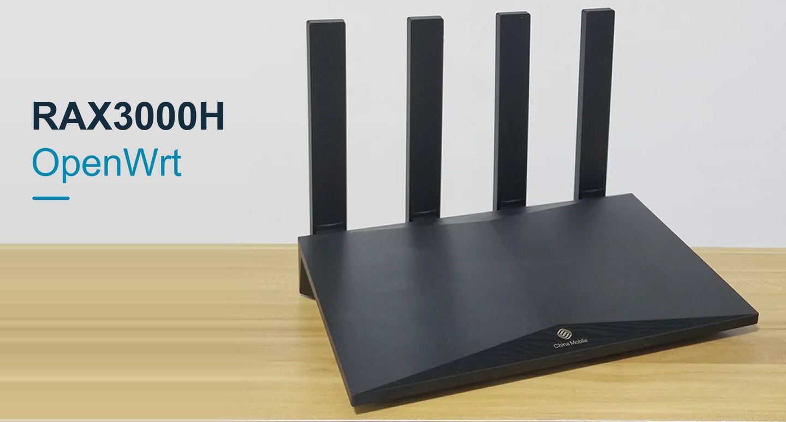
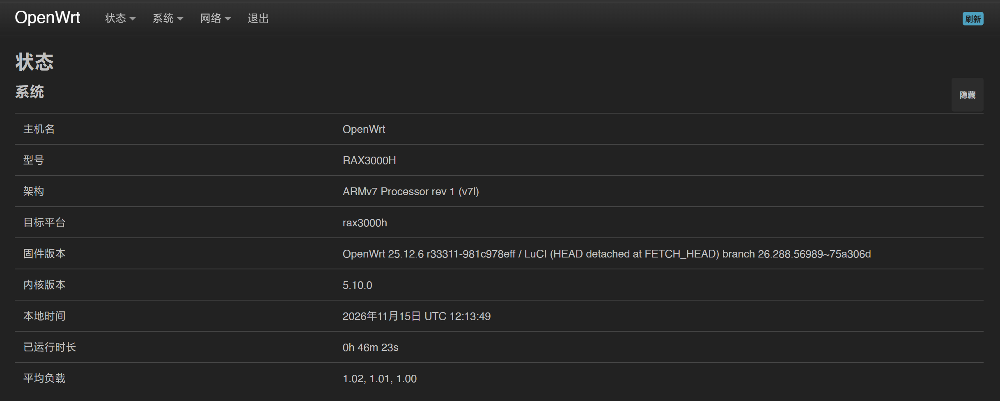
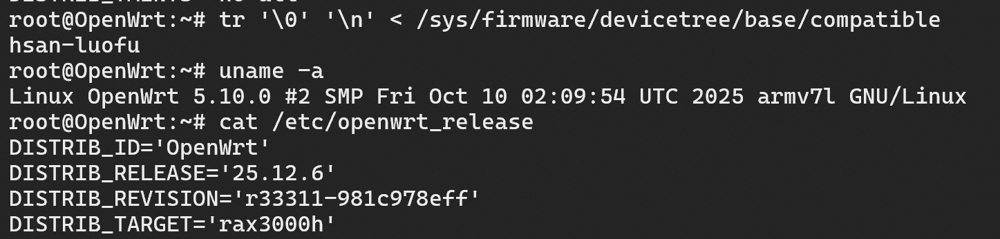
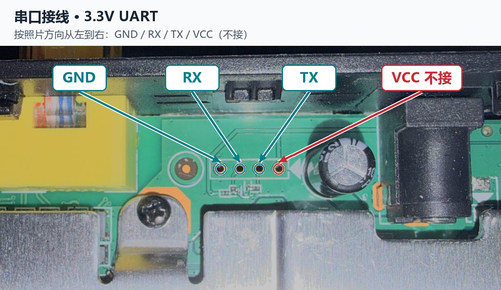

# RAX3000H-OpenWrt

移动 RAX3000H 路由器的 OpenWrt 25 用户态适配。保留原厂内核和驱动，提供熟悉的 OpenWrt 与 LuCI 管理体验。



## 支持功能

- 中文 LuCI 管理界面
- 千兆有线网络、双频 Wi-Fi、硬件转发加速
- WPA2 / WPA3、自动信道、DFS、160 MHz
- DHCP、静态地址、PPPoE 拨号
- IPv4 / IPv6 双栈、防火墙、端口转发
- 配置持久化、恢复出厂设置
- 网页刷写固件、A/B 启动槽管理

## 运行截图

RAX3000H 实机运行 OpenWrt 25.12.6，保留原厂 Linux 5.10.0 内核。



终端读取的设备树标识、实际运行内核和 OpenWrt 版本：



## 刷机

### 1. 连接设备

准备一台装有 Python 3 的 Windows 或 Linux 电脑、一个 **3.3V USB 转串口适配器**和一根网线。本项目刷机测试使用 **CH340**；脚本自动查找串口，无需固定 COM 号。



按照片方向，路由器四个焊孔从左到右为 **GND、RX、TX、VCC**。串口收发需要交叉连接：

| USB 转串口适配器 | 路由器 |
|---|---|
| GND | GND |
| TXD | RX |
| RXD | TX |
| VCC | **不接** |

**必须使用 3.3V 电平，VCC 千万不要接。接错线或使用错误电平有烧毁设备的危险。请断电接线，核对后再通电。**

网线连接电脑和路由器任意 LAN 口，接通路由器电源。

### 2. 下载并运行

从仓库右侧的 **Releases** 下载这三个文件：

- `rax3000h-flasher.zip`
- `installer.cpio.gz`
- `openwrt-rootfs.ubi`

解压压缩包，将另外两个文件放进解压后的目录。在该目录打开终端，执行：

```bash
python -m pip install -r requirements.txt
python flash_openwrt.py
```

Linux 将 `python` 换成 `python3`。

按提示选择串口和有线网卡，**等脚本提示后，再拔插一次路由器电源**。随后会自动备份、安装并重启，刷写期间不要断电。

原始分区备份保存在 `backup` 目录，请妥善留存。

### 3. 进入 OpenWrt

等待路由器重启，打开 **http://192.168.77.1**，出现 LuCI 页面即安装完成。

首次使用 `root`、空密码登录，进入后设置管理密码。Wi-Fi 默认关闭，在「网络 → 无线」中配置并启用。

## 自行构建

详细步骤、环境要求和开发流程见 [Build and development guide](docs/building.md)。

使用 Linux，Windows 请使用 WSL。依赖源码默认放在 `deps/openwrt`，准备脚本自动拉取固定版本，已存在且版本匹配的依赖会跳过下载。

在仓库根目录执行：

```bash
python3 tools/prepare_build.py
python3 tools/build_openwrt.py --jobs 8
python3 tools/build_openwrt_firmware.py
python3 tools/build_installer.py
python3 tools/package_release.py
```

准备脚本负责源码、配置及依赖下载；构建脚本编译工具链和用户空间。缺少系统构建依赖时，按脚本提示安装后重跑即可。发布产物位于 `dist/release`。

本项目沿用原厂内核，不能直接安装 OpenWrt 官方内核模块（kmod）。公开镜像不包含原厂私有驱动、固件或设备校准数据，安装时从本机提取。

## 免责声明

本项目为个人开发的非官方适配，与设备厂商及 OpenWrt 官方无关。刷机有风险，请确认设备型号、正确接线并妥善保存备份。使用本项目造成的设备损坏、数据丢失等后果由使用者自行承担。

## 许可证

除文件中另有许可声明外，本仓库代码采用 [GNU GPL v2.0 only（GPL-2.0-only）](LICENSE)。已标注 MIT 的文件继续采用 [MIT 许可证](LICENSES/MIT.txt)；上游代码、补丁涉及的原始代码及构建产物中的第三方组件遵循各自许可证，原有版权和许可声明继续有效。原厂私有驱动、固件和设备校准数据不在本仓库的许可授权范围内，也不随公开镜像分发。

## 请勿倒卖（倡议）

本项目免费提供，欢迎分享和交流。请尊重开发者的劳动，不要将本项目固件或刷机包包装成付费资源倒卖。此为作者倡议，不构成许可证的额外限制；商业使用和再分发遵循相应许可证。
